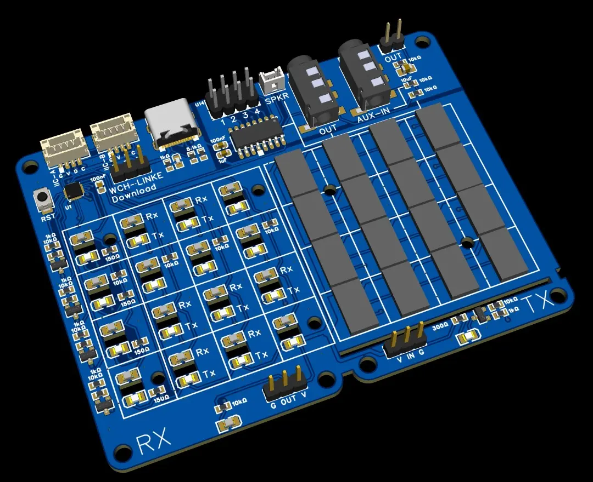

## 项目目标

本项目是一个嵌入式单板的测试项目。主要用于验证红外对管用于反射、遮断探测的实际效果。



项目相关硬件描述： [电路图](specs/IRMatrixV1.0_sch.pdf)

使用 MounRiver Studio3 打开。

软件涉及功能总共包括五个部分：红外反射探测矩阵、红外遮挡探测、ch7800音频芯片驱动、ws2812彩灯驱动 和 IIC从设备逻辑。


### 主循环架构

软件不使用嵌入式操作系统，主体以循环为主要结构。

代码需要实现重要函数 
```c
uint32_t now_msec;

uint32_t now_ms(){
	//获取当前  now_msec
}

bool isTimeout(uint32_t deadline){
	return (int32_t)(now_ms() - deadline) >= 0;
}

```

在ch32v003芯片上建议使用  32 位系统时基（SysTick）做 1ms 中断累加。

主循环的形态：

```c
	uint32_t timeout1 = now_ms();
	uint32_t timeout2 = now_ms();

    while (1)
    {	   
	    if(isTimeout(timeout1))
	        timeout1 = task1_run(ctx1);
	    if(isTimeout(timeout2))
	        timeout2 = task2_run(ctx2);
    }
```

单个任务的形态：

```c
uint32_t task(ctx){
	switch(ctx->state){
	case STEP1:
		//do something
		ctx->state = STEP2;
		return now_ms()+10; //delay 10ms
	case STEP2:
		//do something
		ctx->state = OTHER_STEP;
		return now_ms(); //can run next step immediately
	// ...
	}
	return now_ms();
}
```


### 红外反射探测矩阵


本功能维持16个比特信息，对应四行四列红外探测状态。
第一行对应 IRmatrix 低四位bit0~bit3，
第二行对应 bit4~bit7，
第三行对应 bit8~bit11，
第四行对应 bit12~bit15。

每一行发射管（对应 IR_OUT0～3）点亮2ms，四列同时读取（IR_IN0～3）。低电平表示激活，对应bit设置1，反之设0，可读取4bits。
读取之后关闭发射管，等候6ms。

IR_OUT0 点亮时，获取数据放入IRmatrix bit0~bit3。
IR_OUT1 点亮时，获取数据放入IRmatrix bit4~bit7。
IR_OUT2 点亮时，获取数据放入IRmatrix bit8~bit11。
IR_OUT3 点亮时，获取数据放入IRmatrix bit12~bit15。

如此循环各行，每一行用时8ms。四行扫描周期32ms。
可以做到一秒扫描30次左右。

矩阵方向定义：
左上角，第一行第一列 红外发光管、光敏三极管相关引脚分别为 IR_OUT0、IR_IN0。
右下角，第四行第四列 红外发光管、光敏三极管相关引脚分别为 IR_OUT3、IR_IN3。


下面为该部分功能定义了主要的状态。
```c
//将延时时间定义在宏中

#define MATRIX_LIGHTUP_TIME 2
#define MATRIX_DELAY_TIME 6

typedef enum {
	STEP_ROW0_LIGHTUP = 0, //点亮第一行红外led
	STEP_ROW0_READ,//读取四列传感器数据 4bits
	STEP_ROW1_LIGHTUP, //点亮第二行红外led
	STEP_ROW1_READ,//读取四列传感器数据 4bits
	STEP_ROW2_LIGHTUP, //点亮第三行红外led
	STEP_ROW2_READ,//读取四列传感器数据 4bits
	STEP_ROW3_LIGHTUP, //点亮第四行红外led
	STEP_ROW3_READ,//读取四列传感器数据 4bits
} state_irMatrix_t;

volatile uint16_t IRmatrix;

```

```c
uint32_t task_matrix(ctx){
	switch(ctx->state){
	case STEP_ROW0_LIGHTUP:
		matrixLightOnRow(0);
		ctx->state = STEP_ROW0_READ;
		return now_ms() + MATRIX_LIGHTUP_TIME;
	case STEP_ROW0_READ:
		//读取4比特，填充 IRmatrix bit0～3
		matrixLightOffRow(0);
		ctx->state = STEP_ROW1_LIGHTUP;
		return now_ms() + MATRIX_DELAY_TIME;

	// ...
	case STEP_ROW3_LIGHTUP:
		matrixLightOnRow(3);
		ctx->state = STEP_ROW3_READ;
		return now_ms() + MATRIX_LIGHTUP_TIME;
	case STEP_ROW3_READ:
		//读取4比特，填充 IRmatrix bit12～15
		matrixLightOffRow(3);
		ctx->state = STEP_ROW0_LIGHTUP;
		return now_ms() + MATRIX_DELAY_TIME;
	}
	return now_ms();
}
```


### 红外遮挡探测


该功能使用 IR_TX、IR_RX 信号完成，逻辑与矩阵探测类似。点亮3ms，读取光敏传感器状态，关闭红外led，再延时30ms。

下面为该部分功能定义了主要的状态。
```c
#define IR_LIGHTUP_TIME 3
#define IR_DELAY_TIME 30

typedef enum {
	STEP_IR_LIGHTUP = 0, //点亮红外led
	STEP_IR_READ,//读取传感器
} state_irBreak_t;

uint8_t IRFlag;

```

示例任务：

```c
// 当前状态，低电平为设1，反之为0。
volatile uint8_t IRFlag;

uint32_t task_ir(ctx){
	switch(ctx->state){
	case STEP_IR_LIGHTUP:
		//点亮红外led
		IRLightOn();
		ctx->state = STEP_IR_READ;
		return now_ms() + IR_LIGHTUP_TIME; //delay
	case STEP_IR_READ:
		//传感器更新 IRFlag
		IRFlag = xxx();
		IRLightOff();
		ctx->state = STEP_IR_LIGHTUP;
		return now_ms() + IR_DELAY_TIME;
	}

	return now_ms();
}
```


### ch7800音频芯片驱动

该芯片只需要通过串口发送指令即可控制。
其串口波特率为9600。输出指令如下格式：

	7E 13 00 02 00 xx EF

七个字节中xx 表示需要播放的节目号（ 0～255）。
串口发送使用中断实现。发送一个字节中断发生发送下一个。缓存发送完毕，则关闭中断。

提供接口函数：
```c
void ch7800_play(uint8_t n);
```

### ws2812彩灯驱动

软件需要实现一个简单的函数 ws2812_bitset(uint16_t bits)。
红外探测矩阵的16个单元，对应16个led灯，相应bit为1，点亮相应灯即可，其数值可以使用 0x404040。

```c
void ws2812_bitset(uint16_t bits){
	//本函数参数是一个16比特的无符号数
	//任何位置的比特为1，则点亮16串中相应位置上的led灯，数值可以使用 0x404040
}
```

建议采用pwm+dma方式完成时序模拟，可以参考：
https://github.com/fabian-bxr/CH32V003-WS2812


### 红外事件展示

红外反射矩阵和遮挡对管发生相应事件时，可以通过播放音频以及点亮彩色led去展示效果。
该过程为周期性检测实施，逻辑如下。

定周期检测 遮断传感器 IRFlag 和 矩阵 IRmatrix 16个bit 的状态，发送播放节目的指令 以及输出ws2812序列。

检测遮断传感器 IRFlag 变量，若其值非0， 则播放 0 号节目，控制全部ws2812 灯串点亮。

若未检测遮断事件，则检查 IRmatrix。从 bit0 开始，发现 bit n 为1，则发送指令播放该 n + 1 的节目，同时灯串中对应比特所有为 1 的灯都点亮。
(同时只能播放一个节目，但可以点亮很多灯)
若没有任何传感器激活，则不作任何展示。

示例实现：
```c
#define PLAY_AUDIO_DELAY 500 //500ms 在测试过程中是可以调整的
uint8_t lastPlay = 0xFF;
uint32_t task_play_audio(){
	if(IRFlag !=0){
		//播放音频
		if(lastPlay != 0){ //该逻辑避免重复播放
			ch7800_play(0);
			lastPlay = 0;
		}
		ws2812_bitset(0xFFFF);
	}
	else if(IRmatrix != 0){
		//根据 IRmatrix 最低非零位发送节目指令
		int n = lowIndexOf(IRmatrix)+1;
		if(lastPlay != n){ //该逻辑避免重复播放
			ch7800_play(n);
			lastPlay = n;
		}
		ws2812_bitset(IRmatrix);
	}
	else{
	 	lastPlay = 0xFF;
		ws2812_bitset(0x0000);//熄灭
	}

	return now_ms() + PLAY_AUDIO_DELAY;//延时
}
```

### IIC从设备逻辑

从设备地址设置为：0x36。
每次读取两个字节，即为上文定义的：IRmatrix 变量，先读取低字节，再读取高字节。
其使用中断方式运作。
主机读到的字节顺序为低字节在前。
从机随主机速率。

## 其他细节

- 使用内部振荡器，主频48MHz
- 红外反射矩阵的发射接收和单独一路红外遮断传感器的发射接收，不存在红外光相互串扰影响。
- IIC 主机侧会处理好两根信号线的上拉
- 在main()中，各个功能部件初始化之后，进入主循环之前，可以先安排调用 ch7800_play(0) 一次，再调用 ws2812_bitset(0xA5A5)，之后阻塞?`Delay_Ms(3000)`3秒。以此先测试一下两个功能。
